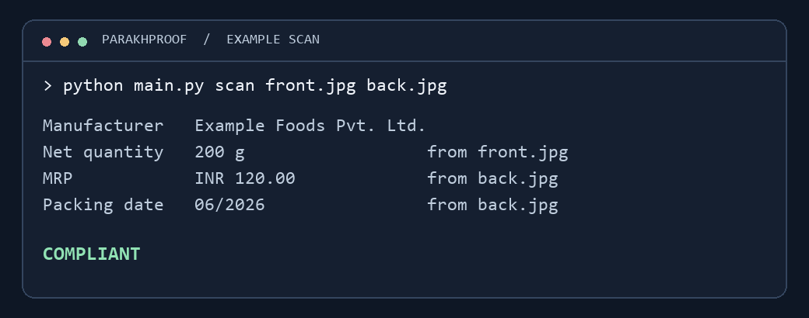

# ParakhProof

**Screen Indian retail packaging labels from a photo.**


ParakhProof reads package declarations with a vision model you configure, then checks the extracted data against built-in Legal Metrology rules. Scan several sides of one package or screen a folder of product photos in one run.



*Illustrative output for a fictional label.*

## Get started

Install the dependencies from the project folder.

```sh
python -m pip install -r requirements.txt
```

Copy `.env.example` to `.env`.

```powershell
Copy-Item .env.example .env
```

On macOS or Linux, use `cp .env.example .env`. Fill in these settings, or set them as environment variables to override the file.

| Setting | What to enter |
| --- | --- |
| `VISION_BASE_URL` | Your provider's OpenAI-compatible API base URL, including the version path if required |
| `VISION_MODEL` | Your provider's image-capable model ID |
| `VISION_API_KEY` | Your API key for that provider |

The endpoint must accept inline base64 image data URLs through Chat Completions. Each scan sends the selected photos to the endpoint you configure. Keep your real key in your local `.env` or environment.

## Scan your photos

```sh
python main.py scan front.jpg back.jpg
python main.py batch path/to/photos
```

- **`scan`** accepts one or more photos of the same package. It shows extracted declarations, the photo that supplied each value when merging several views, and conflicts or warnings.
- **`batch`** treats each image in a folder as a separate product and prints totals for each outcome.
- Both commands accept `--product` as an optional hint for the built-in pack-size checks. Supported images are JPEG, PNG, and WebP, up to 20 MB each.

## Read the verdict

| Verdict | Meaning |
| --- | --- |
| `COMPLIANT` | The built-in checks reported no violations. Warnings can still appear. |
| `NON-COMPLIANT` | The built-in checks flagged one or more potential violations. |
| `UNVERIFIABLE` | The tool extracted too few core declarations to issue a verdict. |

Use results for preliminary screening. Review the source label and applicable requirements before relying on a verdict.
